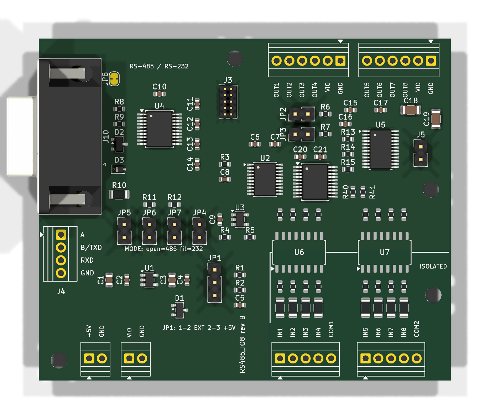

# RS485_IO8 — revision B

**8 isolated inputs** (5–24 V, wired as sink or source) and **8 outputs**
(low-side, high-side, push-pull or PWM), with a host link that a strap
switches between **RS-485 (half duplex) and RS-232**, plus a **USB-C port**
(CH340C USB-serial) on the same UART. All parts are
available from LCSC. Open `RS485_IO8.kicad_pro` in KiCad 9 or 10. The
schematic has an overview page and five sheets; `RS485_IO8.pdf` is the
plotted copy.

Firmware: `../software` (Modbus RTU slave, CMake).

## What changed from rev A

| | rev A | rev B |
|---|---|---|
| Schematic | every pin ended in a net label | real wiring inside each functional block, framed blocks, notes and tables on every sheet, overview page with connector/strap tables |
| Host interface | THVD1410 (RS-485 only) | **MAX3160** multiprotocol transceiver, RS-485 or RS-232 set by the **MODE strap** |
| I/O split | 8 combined I/Os (driver output + non-isolated NPN read-back on the same terminal) | **8 dedicated outputs + 8 dedicated isolated inputs** |
| Inputs | 47k/22k + BC847 level shifter, 0–VIO only | **TLP290-4 bidirectional optocouplers**, 5–24 V, two isolated groups with their own COM, sink or source |
| Output driver | DRV8908-Q1 (not stocked at LCSC) | **DRV8912-Q1**, pin-compatible superset; OUT1–OUT8 used, OUT9–OUT12 unconnected |
| USB | – | **USB-C (J11) with CH340C** virtual COM port on the same UART; VBUS can power the board |
| Connectors | 2.54 mm pin headers | **2.54 mm screw terminals** (Xinya XY308) for 5 V, VIO, serial and all I/O |
| Parts | generic | every part has an LCSC number, MPN and manufacturer (`BOM.csv`, `BOM_JLCPCB.csv`) |

Rev A is kept unchanged in `archive/rev_A/`.

## Sheets

1. **Overview**: block flow, connector and strap tables.
2. **Power**: J1 5 V input, AP2112K 3.3 V LDO, J2 + JP1 output supply (VIO) selection, VIO monitor divider.
3. **MCU**: STM32G030F6P6, reset, 24AA02 EEPROM, address straps, SWD header.
4. **Serial**: MAX3160, MODE strap, TVS protection, termination, bias, J4 terminal, J10 DB9;
   USB-C J11 with USBLC6 ESD protection, CH340C and the UART_RX wired-AND.
5. **Driver**: DRV8912-Q1 with decoupling and pull-ups, output terminals J6/J7.
6. **Inputs**: input terminals J8/J9, 2 × TLP290-4 optocouplers, MCP23S08 SPI expander.

## Connectors

All are 2.54 mm screw terminals unless noted.

| Ref | Name | Pins |
|---|---|---|
| J1 | 5V IN | 1 = +5 V, 2 = GND (regulated 4.75–5.25 V) |
| J2 | VIO EXT IN | 1 = EXT_VIO, 2 = GND (4.5–14 V, used with JP1 1-2); top edge, left of J6 |
| J4 | SERIAL | 1 = A, 2 = B / TXD, 3 = RXD, 4 = GND |
| J11 | USB-C | USB 2.0 device (CH340C virtual COM port), 5.1k on CC1/CC2; VBUS can power the board |
| J10 | DB9 SERIAL (female, right angle) | 1 = A, 2 = B / TXD, 3 = RXD, 5 = GND, 6 = +5 V (via JP8), shell = GND; J4 and J10 are in parallel |
| J6 | OUT1-OUT4 | 1 = GND, 2 = VIO, 3 = OUT4, 4 = OUT3, 5 = OUT2, 6 = OUT1 (on the board, left to right: OUT1 … OUT4, VIO, GND) |
| J7 | OUT5-OUT8 | 1 = GND, 2 = VIO, 3 = OUT8, 4 = OUT7, 5 = OUT6, 6 = OUT5 (on the board, left to right: OUT5 … OUT8, VIO, GND) |
| J8 | IN1-IN4 COM1 | 1–4 = IN1–IN4, 5 = COM1 (isolated) |
| J9 | IN5-IN8 COM2 | 1–4 = IN5–IN8, 5 = COM2 (isolated) |
| J3 | SWD | ARM Cortex 10-pin 1.27 mm header (pin header, not a terminal) |
| J5 | FAULT TEST | 2.54 mm header: 1 = DRV8912 nFAULT, 2 = GND |

## Straps

All straps use 2.54 mm shunts.

| Ref | Name | Setting |
|---|---|---|
| JP1 | VIO SELECT | 1-2 = external VIO from J2, 2-3 = on-board +5 V. Fit exactly one shunt and move it only with power removed. |
| JP2 | ADDR0 | fitted = 0 (firmware adds 1 to the address) |
| JP3 | ADDR1 | fitted = 0 (firmware adds 2 to the address) |
| JP4 | MODE | **open = RS-485, fitted = RS-232** |
| JP5 | TERM | 120 Ω across A/B; RS-485 bus ends only |
| JP6 / JP7 | BIAS A / BIAS B | 390 Ω fail-safe bias; fit both on one RS-485 node per bus |
| JP8 | 5V ON PIN 6 | solder jumper, bridged by default: +5 V on DB9 pin 6. Cut it to remove +5 V from the DB9 |

### Serial interface wiring

| J4 pin | DB9 pin | RS-485 (MODE open) | RS-232 (MODE fitted) |
|---|---|---|---|
| 1 | 1 | A (non-inverting) | leave open (unused T2OUT) |
| 2 | 2 | B (inverting) | TXD, output of this board |
| 3 | 3 | – | RXD, input of this board |
| 4 | 5 | GND | GND |
| – | 6 | +5 V (JP8) | +5 V (JP8) |

The DB9 is a female socket with a DCE pinout. A straight (not null-modem)
cable from a PC or USB-RS232 adapter works: the PC transmits on pin 3 and
receives on pin 2. Pin 6 carries the board's +5 V rail. A host can power the
board through it, or the board can supply a small converter. Pin 6 is DSR on
a standard PC port, so **cut JP8** if the DB9 will ever connect to equipment
that drives pin 6.

The MAX3160 shares its driver pins between the two protocols: in RS-232 mode
the B pin carries TXD. **Remove TERM, BIAS A and BIAS B in RS-232 mode**,
otherwise they load TXD. The MAX3160 receiver is fail-safe, so bias is only
needed when other nodes on the bus are not. A/B naming differs between
vendors, so check the polarity against the host.

RS-485 runs half duplex (HDPLX tied high) with the slew-rate-limited driver
(FAST tied low, ≤ 250 kbit/s). DE has a pull-down, so the bus driver stays off
until the firmware enables it. The receiver is always on, and the firmware
discards its own echo.

### USB-C serial

J11 is a USB 2.0 Type-C device port (HRO TYPE-C-31-M-12). A CH340C (U10)
turns it into a virtual COM port on USART1, so the Modbus RTU firmware
works over USB unchanged. Windows 10/11, Linux and macOS have CH34x drivers
built in or available from WCH.

* **Shared UART.** UART_TX drives both the MAX3160 and the CH340C. UART_RX is
  a wired-AND: D5 (BAT54A, common anode) and the 4.7 kΩ pull-up R44 combine
  the MAX3160 receiver output and the CH340C TXD, so either one can pull
  the line low. Both host links are always live, so **use only one host at a
  time**. In RS-485 mode, traffic from other bus nodes would collide with
  USB data. Replies to a USB host also go out on RS-485 / RS-232. The
  pull-up and diode drop are fine up to 115 200 baud.
* **Power from USB.** VBUS reaches the +5V rail through D4 (B5819W, about
  4.6 V at the rail), so the board runs from USB alone. J1 and USB can both
  be connected: the higher supply wins and D4 blocks back-feeding into the
  PC. USB supplies at most 500 mA by default (5.1 kΩ CC pull-downs). With
  JP1 at 2-3, VIO also comes from this rail, so keep output loads small when
  running from USB.
* U9 (USBLC6-2SC6) protects D+, D− and VBUS. The shield is tied to GND.
* The CH340C runs from +3V3 (V3 tied to VCC), so its I/O matches the STM32.
  CTS, DSR, RI, DCD, DTR and RTS are not used.

## Inputs: sink or source

Each input is a bidirectional opto LED with a 3.3 kΩ series resistor, wired
between the INx pin and the group's COM pin. Current in either direction
makes the input active, so the polarity is chosen by wiring COM. No strap is
needed:

| Field device | Connect COM to | Input is active when |
|---|---|---|
| PNP sensor / switch to +V (source) | GND of the field supply | INx is connected to +V |
| NPN sensor / switch to GND (sink) | +V of the field supply | INx is connected to GND |

* IN1–IN4 / COM1 and IN5–IN8 / COM2 are two separate groups. Each group can
  be wired either way, and each can use its own field supply.
* 5–24 V nominal (30 V max). On above about 4 V, off below about 2 V. A
  4.7 kΩ shunt across each LED makes small leakage currents read as off.
* Input current is about 0.9 mA at 5 V and 6.6 mA at 24 V. The series
  resistor is a 1206 / 0.25 W part.
* The field side is galvanically isolated from the logic (TLP290-4, 2.5 kVrms).
  Keep field-side copper away from logic copper in the layout.
* Active = 1 in firmware. A per-input invert setting covers normally-closed
  contacts.

## Outputs

* Each output can be off, a low-side switch (to GND), a high-side switch (to
  VIO) or push-pull, optionally with PWM. Loads return to the VIO / GND pins
  of the same terminal. VIO is 4.5–14 V (JP1).
* **PWM:** the DRV8912 has 4 PWM generators (80 / 100 / 200 / 2000 Hz,
  8-bit duty). All eight outputs can use PWM, but they share at most four
  duty/frequency settings.
* Don't drive an output from outside above VIO or below GND (body diodes).
  The output side has no isolation, reverse-polarity or load-dump protection.

## PCB

`RS485_IO8.kicad_pcb` is placed but **not routed**. It's 82 × 68 mm, 4 layers:

| Layer | Use |
|---|---|
| F.Cu | signals, components |
| In1.Cu "GND" | GND plane (zone, filled) |
| In2.Cu "PWR" | +3V3 plane (zone, filled); route VIO / +5V as wide traces |
| B.Cu | signals |

KiCad applies its default 1.6 mm 4-layer stack-up. Set the real one under
*Board Setup → Physical Stackup* to match the board house (e.g. JLCPCB
JLC04161H-7628).



* **Left edge:** DB9 J10 directly above USB-C J11, the pair centred on the
  edge. The DB9 pin-6 jumper JP8 sits next to the DB9. The ESD array U9,
  VBUS diode D4, CC resistors and the CH340C U10 sit between J11 and the
  LDO. The UART_RX wired-AND (D5, R44) sits below the MAX3160.
* **Top edge:** VIO input J2, then output terminals J6 and J7, with the
  DRV8912 and its capacitors right below them. Left to right the edge reads
  GND VIO | OUT1 OUT2 OUT3 OUT4 VIO GND | OUT5 OUT6 OUT7 OUT8 VIO GND. The
  terminal pin numbers run the other way (J6/J7 pin 1 = GND, J2 pin 1 =
  VIO), because a top-edge terminal with its wire entry facing out has pin 1
  on the right. The VIO select strap JP1 sits next to J2, so the external
  VIO path stays short; route VIO (JP1 → DRV8912 VM, J6/J7 VIO pins) and
  the +5V feed to JP1 pin 3 as wide traces.
* **Bottom edge:** power terminal J1 (+5 V) and serial terminal J4 on the
  left, isolated input terminals J8 (IN1–4, COM1) and J9 (IN5–8, COM2) on
  the right. Each input is one straight column: terminal pin → 3.3k series
  resistor → 4.7k shunt → opto LED, with the opto's phototransistor and
  22k pull-up directly above it.
* **Middle:** MAX3160 with protection, termination/bias jumpers and the MODE
  strap; LDO; STM32 with the VIO monitor divider next to its ADC pin,
  EEPROM, SWD header (J3), address straps and the MCP23S08.
* **Mounting holes:** 4 × M3 in the corners, 4 mm from both edges.
* The terminals sit on the long edges, so the board doesn't fit standard
  Eurocard card guides.
* **Isolation barrier:** drawn on Dwgs.User along the opto centre line
  (y = 42.5 mm from the top edge) and down at x = 42 mm. A rule area
  `ISOLATED_FIELD` blocks zone fills on all copper layers below / right of
  it, so neither plane reaches the field side. Inside that area route only
  terminal → series resistor → shunt → opto LED, and no logic traces.
* Pin labels for every terminal are on the silkscreen (the edge terminals
  carry no reference text; their pin labels identify them). Terminal wire
  entries face the board edge.
* DRC with schematic parity: 0 errors. The only warnings are 2 USB-C silk
  lines that cross the board edge, which is normal for an edge connector,
  plus the unrouted connections. Footprints carry the
  LCSC/MPN/datasheet fields and are linked to the schematic, so *Update PCB
  from Schematic* keeps the placement.
* Check the DB9 footprint
  (`DSUB-9_Socket_Horizontal_P2.77x2.84mm_EdgePinOffset7.70mm_Housed_MountingHolesOffset9.12mm`)
  against the D-DMR009PF-D002 datasheet before ordering. Pin row to edge
  is 7.7 mm, and the board-lock holes are 25 mm apart and 9.12 mm from the
  edge.

## Part choices

All parts are LCSC-sourced. Stock is from the LCSC/JLCPCB catalogue snapshot
of 2026-11-17.

| Ref | Part | LCSC | Stock | Note |
|---|---|---|---|---|
| U1 | AP2112K-3.3TRG1 | C51118 | 12.5k | 600 mA LDO |
| U2 | STM32G030F6P6 | C724040 | 2.2k | |
| U3 | 24AA02T-I/OT | C478090 | 608 | |
| U4 | MAX3160EAP+T | C406604 | 4.1k | about $4.90, the most expensive part |
| U5 | DRV8912QPWPRQ1 | C1855817 | 2.4k | footprint with thermal vias |
| U6, U7 | TLP290-4(GB-TP,E | C39031 | 15.9k | quad AC-input opto, CTR 100–400 % |
| U8 | MCP23S08T-E/SS | C145600 | 389 | lowest stock; MCP23S08-E/SS C144204 is the same die |
| J8, J9 | XY308-2.54-5P | C915914 | 6.3k | |
| D2 | SM712 | C7420375 | 539k | RS-485 TVS |
| D3 | H15VND3B | C20615813 | 803k | 15 V bidirectional TVS, RS-232 RXD |
| J1, J2 | XY308-2.54-2P | C557685 | 5.6k | |
| J4 | XY308-2.54-4P | C915913 | 5.0k | |
| J6, J7 | XY308-2.54-6P | C915915 | 1.1k | |
| J10 | D-DMR009PF-D002 (DB9 female, right angle) | C141882 | 47k | verify footprint, see PCB |
| J11 | TYPE-C-31-M-12 (USB-C 16P) | C165948 | 368k | |
| U10 | CH340C | C84681 | 124k | USB-UART, no crystal |
| U9 | USBLC6-2SC6 (UMW) | C2687116 | 58k | USB ESD |
| D4 | B5819W | C8598 | 385k | VBUS → +5V, Basic part |
| D5 | BAT54A,215 | C130910 | 149k | UART_RX wired-AND |

Passives are JLCPCB "Basic" parts where possible. `BOM.csv` has every line
with value, rating, MPN, library type, stock and unit price.
`BOM_JLCPCB.csv` is in JLCPCB assembly format.

## MCU pin assignment

This is unchanged from rev A; see `software/firmware/board.h`.

| Pin | Signal | Function |
|---|---|---|
| 1 | PB7 AF6 | I2C1 SDA (EEPROM) |
| 2 | PC14 | ADDR0 strap |
| 3 | PC15 | ADDR1 strap |
| 7 | PA0 | ADC_IN0, VIO monitor (`VIO × 22/122`) |
| 8 / 9 / 13 | PA1 / PA2 / PA6 | SPI1 SCK / MOSI / MISO |
| 10 | PA3 | expander IRQ (EXTI3) |
| 11 | PA4 | driver nCS |
| 12 | PA5 | expander nCS |
| 14 | PA7 | driver nSLEEP |
| 15 | PB0 | transceiver DE485/T2IN |
| 16 / 17 | PA9 / PA10 (SYSCFG remap of PA11/PA12) | USART1 TX / RX (MAX3160 and CH340C; RX is a wired-AND) |
| 18 / 19 | PA13 / PA14 | SWDIO / SWCLK |
| 20 | PB6 AF6 | I2C1 SCL |

## Regenerating and checking

The schematic is generated, so don't edit the `.kicad_sch` files by hand:

```bash
python3 tools/gen_schematic.py   # writes the .kicad_sch files and IO8.kicad_sym
                                 # (stock symbols from /usr/share/kicad/symbols, or $KICAD_SYMBOL_DIR)
python3 tools/check_design.py    # ERC + connectivity/footprint/isolation checks -> VALIDATION.txt, ERC.json
python3 tools/make_bom.py        # BOM.csv, BOM_JLCPCB.csv (stock from the local LCSC snapshot)
kicad-cli sch export pdf -o RS485_IO8.pdf RS485_IO8.kicad_sch
python3 tools/gen_pcb.py         # initial placement only; refuses to overwrite an existing board
```

Once you start routing, maintain the board in KiCad: change the schematic
via the script, then use *Tools → Update PCB from Schematic*. Symbol UUIDs
are stable across regenerations, so the link holds. `gen_pcb.py --force`
recreates the board from scratch and discards routing.

`check_design.py` checks the netlist against a connection list written from
the datasheets, independently of the layout code. It covers every MCU pin,
the MAX3160 / DRV8912 / MCP23S08 / TLP290-4 pin functions, all eight output
and eight input paths, the USB-C / CH340C connections and the UART_RX
wired-AND, isolation of the COM groups from logic nets, supplies and
intended no-connects. For the USB-C change the connectivity checks
(253) pass against a KiCad 10 netlist and KiCad ERC reports 0 violations
(all severities). `VALIDATION.txt` and `ERC.json` still hold the run from
before the USB-C change: re-run `check_design.py` to refresh them.

## Before PCB release

* Not built or hardware-tested.
* Check the DRV8912 PowerPAD land pattern against the ordered TI PWP variant.
* Verify capacitor effective capacitance under DC bias. The VM bulk is
  22 µF / 25 V + 10 µF / 50 V so that at least 10 µF remains at 14 V.
* Validate the opto input thresholds at 5 V and 24 V, start-up sequencing,
  and RS-485 / RS-232 / USB operation on a prototype.
* Route USB D+ / D− as a short 90 Ω differential pair J11 → U9 → U10,
  without vias if possible.
* Keep creepage between the field-side input copper (J8/J9, series
  resistors, opto LED side) and logic copper.

## Source documents

* MAX3160/MAX3161/MAX3162, Maxim/ADI 19-1722
* TI DRV89xx-Q1, SLVSEC9C (DRV8912-Q1 pinout and register map)
* Microchip MCP23008/MCP23S08 DS21919E
* ST STM32G030x6/x8 DS12991, RM0454
* Toshiba TLP290-4 (AC-input quad photocoupler)
* Microchip 24AA02, Diodes AP2112
* WCH CH340 datasheet (CH340C), ST USBLC6-2, HRO TYPE-C-31-M-12
